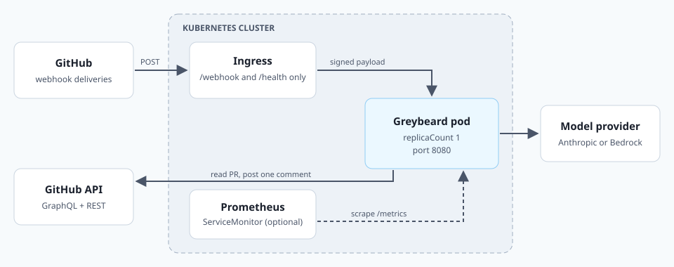
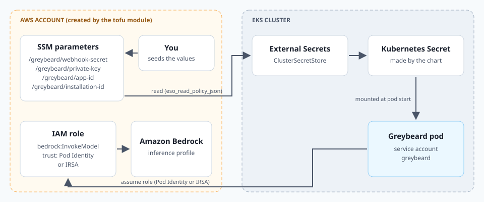

# Deploying Greybeard

Greybeard runs as a small web service. GitHub sends it webhooks, it reviews the pull request, and it posts one comment. This guide covers running it on Kubernetes with the Helm chart in [`charts/greybeard`](../charts/greybeard), plus a plain `docker run` path at the end.

Set up the GitHub App first ([GITHUB_APP.md](GITHUB_APP.md)). You need its App ID, private key, webhook secret, and bot login before anything here will work.

## Architecture



### The moving parts

- **One pod, one container.** The image is `ghcr.io/rei-labs/greybeard`, built for `linux/amd64` and `linux/arm64`. It listens on port `8080`.
- **Three routes.** `POST /webhook` takes GitHub deliveries. `GET /health` reports status. `GET /metrics` serves Prometheus metrics.
- **No database.** The hidden marker inside each PR comment records what was reviewed. Everything else (delivery dedupe, the daily counter, mention cooldowns) lives in memory.
- **One model provider.** Either the **Anthropic API** (an API key) or **Amazon Bedrock** (AWS credentials from the pod's identity).

### Why exactly one replica

The chart only accepts `replicaCount: 0` or `1`, and it fails to render on anything else. The reasons:

- **The PR comment is the state store.** Two pods would both see "not reviewed yet" and race each other, which means double reviews and double spend.
- **The guardrails are in memory.** Dedupe, debounce, and the daily limit only work when one process sees every delivery.
- **Upgrades use `Recreate`.** A rolling update would briefly run two writers, so the old pod stops before the new one starts.

A side effect worth knowing: the daily review counter resets when the pod restarts.

### Image tags

CI publishes to GHCR on every merge to `master` and on every `v*` release tag.

| Tag | Published from | Use it for |
| --- | --- | --- |
| `1.3.0`, `1.3` | release tag `v1.3.0` | **Production.** Pin a full version. |
| `latest` | the newest release tag | Quick trials only. |
| `edge` | the newest `master` commit | Trying unreleased changes. |
| `<sha7>` (for example `9e9ad17`) | every published commit | Pinning an exact build. |

The chart's default tag is its `appVersion` (`1.3.0`). Pin a version or digest, never `latest`.

## Prerequisites

- A Kubernetes cluster and **Helm 3**.
- A public **HTTPS** hostname that GitHub can reach, plus an ingress controller (or another way to expose a Service).
- The GitHub App values from [GITHUB_APP.md](GITHUB_APP.md): App ID, `app-key.pem`, `webhook-secret.txt`, and the bot login.
- **One** model provider:
  - Option A: an Anthropic API key.
  - Option B: Amazon Bedrock access on EKS, OpenTofu (or Terraform) 1.6 or newer, and the AWS CLI.
- A copy of the chart. It isn't published to a chart registry, so install it from a clone:

  ```sh
  git clone https://github.com/REI-Labs/greybeard.git
  cd greybeard
  git checkout v1.3.0
  ```

## Implementation

### Option A: Anthropic API (simplest)

The chart creates the Kubernetes Secret for you from values you pass at install time. This is the quickest path, and it's fine for a trial.

There's one tradeoff. Helm keeps those values in its release history, so the secrets live there too. For long-running installs, use an existing Secret (shown below) or Option B's External Secrets setup.

**1. Write a values file.**

```yaml
# values-anthropic.yaml
llm:
  provider: anthropic
  # lensModel: ""      # empty = the app default for Anthropic

github:
  appId: "123456"
  botLogin: "my-reviewer[bot]"

ingress:
  enabled: true
  className: alb       # your ingress class
  annotations:
    alb.ingress.kubernetes.io/scheme: internet-facing
    alb.ingress.kubernetes.io/target-type: ip
    alb.ingress.kubernetes.io/healthcheck-path: /health
    alb.ingress.kubernetes.io/certificate-arn: <your-certificate-arn>
  hosts:
    - greybeard.example.com
```

**2. Install, passing the secrets on the command line.**

```sh
helm install greybeard ./charts/greybeard \
  --namespace greybeard --create-namespace \
  -f values-anthropic.yaml \
  --set-file   secrets.create.privateKey=app-key.pem \
  --set-string secrets.create.webhookSecret="$(cat webhook-secret.txt)" \
  --set-string secrets.create.anthropicApiKey="$ANTHROPIC_API_KEY"
```

Pass the same three `--set` flags on every `helm upgrade`. Without them, the chart has no secret source and refuses to render.

**Prefer a Secret you manage?** Create it once and point the chart at it. Use the key names exactly as shown.

```sh
kubectl -n greybeard create secret generic greybeard-github \
  --from-file=webhook-secret=webhook-secret.txt \
  --from-file=private-key.pem=app-key.pem \
  --from-literal=anthropic-api-key="$ANTHROPIC_API_KEY"
```

```yaml
# add to values-anthropic.yaml
secrets:
  existingSecret: greybeard-github
```

`--from-file` copies the file byte for byte, so `webhook-secret.txt` must not end in a newline. The `tr -d '\n'` step in [GITHUB_APP.md](GITHUB_APP.md#step-1-generate-the-webhook-secret) takes care of that.

### Option B: Amazon Bedrock on EKS

This path keeps every secret out of Helm. An OpenTofu module creates the AWS side, and the **External Secrets Operator** (ESO) copies secrets from AWS SSM Parameter Store into the cluster.

**Why use ESO?** Your secrets stay in one AWS service, under IAM control. The cluster only gets a synced copy, and nothing secret goes into Helm values.



The module ([`deploy/tofu/modules/greybeard-aws`](../deploy/tofu/modules/greybeard-aws)) creates:

- An **IAM role** that can call `bedrock:InvokeModel` and `bedrock:InvokeModelWithResponseStream`.
- A way for the pod to assume that role, picked by `identity_mode`.
- Four **SSM parameters** filled with the placeholder `SEED_ME`, which you overwrite.
- A read-only IAM policy for ESO, as JSON output. The module does not attach it anywhere.
- Optionally, a private ECR repository (`create_ecr_repository = true`).

#### B1. Pick an identity mode

The pod needs AWS credentials to call Bedrock. EKS offers two ways to hand an IAM role to a pod.

| | `pod_identity` (default) | `irsa` |
| --- | --- | --- |
| Cluster needs | The **EKS Pod Identity Agent** add-on | An **IAM OIDC provider** for the cluster |
| Extra tofu inputs | None | `oidc_provider_arn`, `oidc_provider_url` |
| Where `role_arn` goes | Nowhere in the chart. The module creates the association for you. | The service account annotation `eks.amazonaws.com/role-arn` |
| Matching rule | Namespace and service account name must equal the module's `namespace` and `service_account` (both default to `greybeard`) | Same rule. It's baked into the role's trust policy. |

Pod Identity is the newer, simpler option. Choose IRSA if your cluster already uses it.

#### B2. Apply the module

```sh
cd deploy/tofu/examples/eks
cp terraform.tfvars.example terraform.tfvars
# edit: region, cluster_name, identity_mode (and the OIDC values for irsa)
tofu init
tofu apply
tofu output
```

`irsa.tfvars.example` shows the IRSA inputs.

`bedrock_regions` decides which regions the role may call. A **cross-region inference profile** (IDs like `us.anthropic.*`) can route a request to any region in its set. That means the role needs every one of those regions, not just the one you call. The default is `["us-east-1", "us-east-2", "us-west-2"]`. Match it to your profile.

#### B3. Seed the SSM parameters

Seed these before you install the chart. Until then, the parameters hold `SEED_ME`, and every webhook delivery will fail its signature check.

Run the commands in the same region as the tofu `region` variable. The names below assume the default `ssm_prefix` of `/greybeard`. `tofu output ssm_parameter_names` prints the real ones.

```sh
export AWS_REGION=<region-from-terraform.tfvars>

aws ssm put-parameter --overwrite --type SecureString \
  --name /greybeard/webhook-secret --value "$(cat webhook-secret.txt)"

aws ssm put-parameter --overwrite --type SecureString \
  --name /greybeard/private-key --value="$(cat app-key.pem)"

aws ssm put-parameter --overwrite --type String \
  --name /greybeard/app-id --value "123456"

# Optional. The chart does not read this one (see the mapping table below).
aws ssm put-parameter --overwrite --type String \
  --name /greybeard/installation-id --value "<installation-id>"
```

Two details matter here:

- **Use `"$(cat file)"`, not `file://file`.** Command substitution strips the trailing newline. `file://` keeps it, and a newline in the webhook secret breaks every delivery.
- **The private key uses `--value=` with an equals sign.** A PEM starts with `-----BEGIN`, and without the `=` the AWS CLI reads that leading dash as the start of a new option.

Tofu won't overwrite your values on the next `apply`. The module sets `ignore_changes` on the parameter value.

#### B4. Give ESO read access and a store

Attach the module's policy to the IAM identity your ESO controller runs as:

```sh
tofu output -raw eso_read_policy_json > eso-read.json
aws iam put-role-policy --role-name <your-eso-role> \
  --policy-name greybeard-ssm-read --policy-document file://eso-read.json
```

Then make sure there's a store pointing at Parameter Store in the same region. If you don't have one yet, here's a minimal example. Adjust its auth settings to match how your ESO controller gets AWS credentials.

```yaml
apiVersion: external-secrets.io/v1
kind: ClusterSecretStore
metadata:
  name: aws-parameter-store
spec:
  provider:
    aws:
      service: ParameterStore
      region: <region-from-terraform.tfvars>
```

#### B5. Line up SSM names with chart values

This is the step most likely to go wrong. Each chart value must hold the **full SSM parameter name**.

| SSM parameter (`ssm_parameter_names` key) | Chart value | Key in the synced Secret |
| --- | --- | --- |
| `/greybeard/webhook-secret` (`webhook-secret`) | `secrets.externalSecret.remoteRefs.webhookSecret` | `webhook-secret` |
| `/greybeard/private-key` (`private-key`) | `secrets.externalSecret.remoteRefs.privateKey` | `private-key.pem` |
| `/greybeard/app-id` (`app-id`) | `secrets.externalSecret.remoteRefs.appId`, read only when `github.appId` is empty | `app-id` |
| `/greybeard/installation-id` (`installation-id`) | Not read by the chart. Use `github.installationId` if you ever need a pin. | — |
| Not created by the module | `secrets.externalSecret.remoteRefs.anthropicApiKey`, used only with `llm.provider: anthropic` | `anthropic-api-key` |

#### B6. Write the values file and install

```yaml
# values-bedrock.yaml
llm:
  provider: bedrock
  lensModel: us.anthropic.claude-opus-5   # your Bedrock inference profile ID
  awsRegion: us-east-1                    # must be in bedrock_regions

github:
  botLogin: "my-reviewer[bot]"
  # appId comes from SSM via remoteRefs.appId

serviceAccount:
  name: greybeard            # must equal the module's service_account
  # irsa only — paste the role_arn output:
  # annotations:
  #   eks.amazonaws.com/role-arn: <role_arn>

secrets:
  externalSecret:
    enabled: true
    secretStoreRef:
      name: aws-parameter-store
      kind: ClusterSecretStore
    remoteRefs:
      webhookSecret: /greybeard/webhook-secret
      privateKey: /greybeard/private-key
      appId: /greybeard/app-id

ingress:
  enabled: true
  className: alb
  annotations:
    alb.ingress.kubernetes.io/scheme: internet-facing
    alb.ingress.kubernetes.io/target-type: ip
    alb.ingress.kubernetes.io/healthcheck-path: /health
    alb.ingress.kubernetes.io/certificate-arn: <your-certificate-arn>
  hosts:
    - greybeard.example.com
```

```sh
helm install greybeard ./charts/greybeard \
  --namespace greybeard --create-namespace \
  -f values-bedrock.yaml
```

The namespace must equal the module's `namespace` (default `greybeard`).

**After changing an SSM value,** the pod won't see it right away. ESO syncs on `secrets.externalSecret.refreshInterval` (default `1h`), and the pod reads its Secret only at startup. Once the Secret updates, restart the pod:

```sh
kubectl -n greybeard rollout restart deployment/greybeard
```

### Ingress: only two paths

The chart's Ingress routes exactly two paths, both with `pathType: Exact`:

- `/webhook`, so GitHub can deliver events.
- `/health`, so load balancers can check the pod.

`/metrics` runs on the same port but is **never** exposed through the Ingress. It has no authentication, and it reveals usage and spend data. Scrape it from inside the cluster.

Because `/` isn't routed, point your load balancer's health check at `/health`. That's what the `healthcheck-path` annotation in the examples does. `/health` always returns HTTP 200, even when degraded, so one failing review can't get the pod pulled from service.

After install, `helm status greybeard -n greybeard` prints the webhook URL to paste into the App settings.

### Metrics and the ServiceMonitor

If you run the **Prometheus Operator**, turn on the ServiceMonitor:

```yaml
serviceMonitor:
  enabled: true
  interval: 60s
  labels:
    release: prometheus   # whatever your Prometheus selects on
```

Useful series:

| Metric | What it tells you |
| --- | --- |
| `greybeard_reviews_total{outcome=...}` | Runs by outcome: posted, skipped, error, daily-limit, superseded |
| `greybeard_review_duration_seconds` | How long reviews take |
| `greybeard_tokens_total{kind=...}` | Token use by kind |
| `greybeard_cost_microusd_total` | Spend, only when `prices` is set |
| `greybeard_inflight_reviews` | Reviews running right now |
| `greybeard_daily_reviews` | Reviews started today, to compare with the daily limit |
| `greybeard_consecutive_failures` | Failures in a row. At 3, `/health` reports `degraded`. |

Each finished run also writes one `review.done` JSON line to stdout. Ship pod logs with your usual log pipeline, because that line is the durable run record. The chart's `/data` volume is an `emptyDir`, so its JSONL copy disappears with the pod.

To get cost numbers, set all four prices ($ per million tokens). If any one is missing, cost isn't reported, though tokens still are.

```yaml
prices:
  input: "3.0"
  output: "15.0"
  cacheRead: "0.3"
  cacheWrite: "3.75"
```

### Guardrails

These cap spend no matter how many webhooks arrive.

| Setting | Default | What it does |
| --- | --- | --- |
| `guardrails.maxConcurrent` | `2` | Reviews running at once. Extra ones wait their turn. |
| `guardrails.dailyReviewLimit` | `50` | Reviews per UTC day across **every** installed repo. Past the limit, runs are skipped **silently**, with no PR comment. Size it to your volume. |
| `guardrails.reviewBotPrs` | `false` | Skip PRs opened by bots (Dependabot and similar) before any model call. |

These are fixed in code: a 5-second debounce per PR (a new push replaces the in-flight review), and a 10-minute cooldown per person on `@<app-slug> review`.

### Pausing the service

Set `replicaCount: 0` and upgrade. The chart's install notes will warn that the service is off.

While paused, GitHub deliveries fail, and **GitHub does not retry them**. When you scale back to 1, start any reviews you missed by pushing to the PR, commenting `@<app-slug> review`, or using **Redeliver** in the App's Recent Deliveries.

### Upgrading

1. Check out the new release tag (for example `git checkout v1.4.0`) to get the matching chart.
2. Leave `image.tag` empty to follow the chart's `appVersion`, or pin one explicitly.
3. Run `helm upgrade` with the same values file. For Option A with chart-created secrets, pass the `--set` secret flags again.

Expect a short gap during the upgrade. The `Recreate` strategy stops the old pod before starting the new one. Deliveries during that gap fail, and you can redeliver them.

**Private registry.** To run from your own registry, copy the image there and set `image.repository` (plus `imagePullSecrets` if needed). Forks can turn on CI's built-in ECR mirror by setting the repo variables `AWS_ROLE_ARN`, `AWS_REGION`, and `ECR_IMAGE`. It copies each `master` build's `<sha7>` tag.

### Without Kubernetes: `docker run`

The same image runs anywhere Docker does. The default command is `serve` on port `8080`.

```sh
docker run -d --name greybeard -p 8080:8080 \
  -v "$PWD/app-key.pem:/run/app-key.pem:ro" \
  -e GREYBEARD_APP_ID=123456 \
  -e GREYBEARD_APP_PRIVATE_KEY=/run/app-key.pem \
  -e GREYBEARD_WEBHOOK_SECRET="$(cat webhook-secret.txt)" \
  -e GREYBEARD_BOT_LOGIN='my-reviewer[bot]' \
  -e ANTHROPIC_API_KEY="$ANTHROPIC_API_KEY" \
  ghcr.io/rei-labs/greybeard:1.3.0

curl -fsS http://localhost:8080/health
```

Things to handle yourself:

- **HTTPS.** Put a TLS-terminating proxy in front, and forward only `/webhook` and `/health`.
- **Key permissions.** The container runs as UID `10001`, which must be able to read the mounted key.
- **Bedrock instead of Anthropic.** Set `GREYBEARD_PROVIDER=bedrock`, `GREYBEARD_LENS_MODEL=<inference-profile-id>`, and `AWS_REGION`. Then provide AWS credentials through the standard AWS credential chain, such as environment variables or a mounted config.
- **One container only.** The single-replica rule applies here too.

The [README](../README.md#configuration-env) lists every environment variable.
