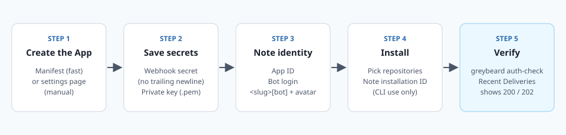

# GitHub App setup

Greybeard talks to GitHub as a **GitHub App**. The App gives it a bot identity (comments post as `<app-slug>[bot]`), a webhook that tells it when pull requests change, and short-lived tokens scoped to the repositories you choose.

This guide walks through creating that App. You will finish with five values that the deploy guide ([DEPLOY.md](DEPLOY.md)) asks for:

| Value | Secret? | Used for |
| --- | --- | --- |
| **App ID** | No | Signing the token request |
| **Private key** (`.pem`) | Yes | Signing the token request |
| **Webhook secret** | Yes | Checking that deliveries really came from GitHub |
| **Bot login** (`<app-slug>[bot]`) | No | Ignoring its own comments and defining the `@<app-slug> review` command |
| **Installation ID** | No | Only for running the CLI as the App (the service reads it from each webhook) |



## Architecture: what the App needs and why

Greybeard reads a pull request, its history, and its CI status, then writes **one** comment. It never pushes code, approves, or requests changes. The permission set is the smallest one that covers the calls in the code.

### Permissions

| Permission | Access | Why Greybeard needs it | Evidence |
| --- | --- | --- | --- |
| **Metadata** | Read | Required by GitHub for every App | GitHub default |
| **Pull requests** | Read and write | PR query (files, comments, head SHA), the unified diff, and review threads on past PRs. Write is what the reference deployment runs with for posting on PRs; Read alone is untested | `src/github/pack.rs:49`, `src/github/pack.rs:116-117`, `src/github/pack.rs:502-506` |
| **Contents** | Read | File contents at the head SHA, `blame`, and commit `history` per file | `src/github/mod.rs:154`, `src/github/pack.rs:445`, `src/github/pack.rs:500` |
| **Issues** | Read and write | A PR comment is an issue comment: Greybeard creates it with `addComment` and edits it with `updateIssueComment` | `src/github/comment.rs:77`, `src/github/comment.rs:88` |
| **Checks** | Read | `CheckRun` entries in the CI status rollup | `src/github/pack.rs:57-61` |
| **Commit statuses** | Read | `StatusContext` entries in the same rollup | `src/github/pack.rs:62` |

The PR query asks for check runs and statuses in the same request as the files and comments. If the App can't read them, that whole query can fail, so don't drop Checks or Commit statuses to save a line.

### Events

| Event | What Greybeard does with it | Evidence |
| --- | --- | --- |
| **Pull request** | Reviews on `opened`, `synchronize`, `ready_for_review`, and `reopened`. Drafts wait for `ready_for_review`. | `src/server.rs:146-161` |
| **Issue comment** | A new PR comment that **starts with** `@<app-slug>` and contains `review` forces a re-review. Each person gets one forced review per 10 minutes. | `src/server.rs:162-200` |

GitHub also sends a `ping` when you create the App. Greybeard answers it with `200 pong`.

## Implementation

### Step 1: Generate the webhook secret

Do this first, so you have it ready for either creation path.

```sh
openssl rand -hex 32 | tr -d '\n' > webhook-secret.txt
```

> **Watch out for the trailing newline.** Greybeard uses the secret exactly as stored, byte for byte. If a newline sneaks in, the HMAC check fails and **every delivery gets `401 bad signature`**. Plain `openssl rand -hex 32 > file` adds one, which is why the command above strips it with `tr`.

To check, `wc -c webhook-secret.txt` should print `64`.

### Step 2, path A: Create the App from the manifest (fast)

A **GitHub App manifest** is a JSON file that pre-fills the App's settings, so permissions and events can't be mistyped. The repo ships one at [`deploy/github-app-manifest.json`](../deploy/github-app-manifest.json).

1. Pick an App name. It has to be unique across GitHub, and its slug becomes the bot's login.
2. Build a small HTML form with your name and webhook URL filled in. Replace `YOUR_ORG`, the name, and the host:

   ```sh
   python3 - <<'EOF' > create-app.html
   import html, json
   m = json.load(open("deploy/github-app-manifest.json"))
   m["name"] = "my-reviewer"
   m["hook_attributes"]["url"] = "https://greybeard.example.com/webhook"
   action = "https://github.com/organizations/YOUR_ORG/settings/apps/new"
   print(f'<form action="{action}" method="post">'
         f'<input type="hidden" name="manifest" value="{html.escape(json.dumps(m))}">'
         f'<button type="submit">Create GitHub App</button></form>')
   EOF
   ```

   For an App owned by your personal account, use `https://github.com/settings/apps/new` as the action instead.
3. Open `create-app.html` in a browser, click the button, and confirm on GitHub.
4. GitHub sends you back to the `redirect_url` (the Greybeard repo page) with `?code=...` in the address bar. Copy that code. It expires after one hour.
5. Trade the code for the App's credentials:

   ```sh
   gh api -X POST /app-manifests/<code>/conversions > app.json
   jq -r '.id, .slug' app.json             # App ID, then slug
   jq -j '.pem' app.json > app-key.pem     # private key
   ```

6. The manifest flow also gives the App a webhook secret of its own (`.webhook_secret` in `app.json`). Replace it with yours: open the App's settings, paste the contents of `webhook-secret.txt` into **Webhook secret**, and save.
7. Delete `app.json` once you have stored the key and secret. It holds both in plain text.

You can still edit any of these settings later in the App's **General** and **Permissions & events** pages.

### Step 2, path B: Create the App by hand

1. Go to **Settings → Developer settings → GitHub Apps → New GitHub App**. For an organization, start from the organization's settings instead.
2. Fill in the basics:
   - **GitHub App name:** your choice, for example `my-reviewer`.
   - **Homepage URL:** `https://github.com/REI-Labs/greybeard` (or your fork).
   - **Webhook:** check **Active**.
   - **Webhook URL:** `https://<your-host>/webhook`.
   - **Webhook secret:** paste the contents of `webhook-secret.txt`.
3. Under **Repository permissions**, set exactly the six permissions in the [Permissions](#permissions) table. Leave everything else at **No access**.
4. Under **Subscribe to events**, check **Pull request** and **Issue comment**. (These boxes only show up after the matching permissions are set.)
5. Under **Where can this GitHub App be installed?**, choose **Only on this account**.
6. Click **Create GitHub App**.

### Step 3: Download the private key

On the App's **General** page, scroll to **Private keys** and click **Generate a private key**. Your browser downloads a `.pem` file.

- Path A already saved the key as `app-key.pem`. You can skip this unless you want to rotate it.
- Treat the file like a password. Anyone holding it can act as your App.
- Keep the file as-is. Greybeard reads it from a file path and parses it as an RSA PEM.

### Step 4: Find the App ID and bot login

- **App ID:** shown at the top of the App's **General** page.
- **App slug:** the last part of the App's public URL, `https://github.com/apps/<app-slug>`.
- **Bot login:** the slug plus `[bot]`, for example `my-reviewer[bot]`.

The bot login does two jobs. Greybeard uses it to skip its own comments, and it defines the command people type to force a review. With a bot login of `my-reviewer[bot]`, the command is a PR comment that starts with:

```text
@my-reviewer review
```

The Helm chart requires it as `github.botLogin`. Outside the chart, it is the `GREYBEARD_BOT_LOGIN` variable, which defaults to `greybeard-bot[bot]`. A wrong value means the `@` command is silently ignored.

### Step 5: Set the avatar

GitHub Apps can't take an avatar through the manifest, so upload it by hand. On the App's **General** page, find **Display information**, click **Upload a logo**, and choose [`assets/avatar-app.png`](../assets/avatar-app.png).

### Step 6: Install the App on repositories

1. Open the App's **Install App** page and pick the account.
2. Choose **Only select repositories** and add the ones you want reviewed. **All repositories** works too, but every PR in every repo will spend model tokens.
3. Note the **installation ID**. It is the number at the end of the page URL after you install, `.../settings/installations/<installation-id>`.

The running service doesn't need the installation ID. Each webhook carries it, so one deployment can serve several installations. You only need it to run the CLI (`review`, `pack`, `auth-check`) as the App.

### Step 7: Verify

**Check the credentials** with `greybeard auth-check`. For the CLI to use the App identity, all three App variables must be set. If any is missing, it falls back to a personal token.

```sh
docker run --rm \
  -v "$PWD/app-key.pem:/run/app-key.pem:ro" \
  -e GREYBEARD_APP_ID=<app-id> \
  -e GREYBEARD_APP_PRIVATE_KEY=/run/app-key.pem \
  -e GREYBEARD_APP_INSTALLATION_ID=<installation-id> \
  ghcr.io/rei-labs/greybeard:1.3.0 auth-check
```

The image runs as UID `10001`, so that user must be able to read the mounted key file.

What a healthy result looks like:

- The first line reads `auth mode: app`.
- The second line starts with `viewer query:` and ends with `(normal for app installation tokens)`. That error is expected. An App token can't look up a "viewer", and the token exchange already proved the credentials work.

If you see `auth mode: user token`, the App variables were not picked up.

**Check the webhook** after you deploy ([DEPLOY.md](DEPLOY.md)). Open the App's settings, then **Advanced → Recent Deliveries**.

| Delivery | Expected response |
| --- | --- |
| `ping` | `200` with body `pong` |
| `pull_request` (opened, pushed to, ready for review, reopened) | `202` with body `queued` |
| `issue_comment` starting with `@<app-slug> review` | `202` with body `queued (forced)` |
| Anything Greybeard doesn't act on | `202` with a short reason, such as `ignored action` |

Any failed delivery has a **Redeliver** button. GitHub does not retry failed deliveries for you.

## Troubleshooting

| Symptom | Likely cause | Fix |
| --- | --- | --- |
| Every delivery returns `401 bad signature` | The App's webhook secret and the deployed secret differ. A trailing newline in the stored copy is the usual culprit. | Recreate the secret with `tr -d '\n'` (Step 1), store it again, paste the same value into the App, and restart the pod so it re-reads the secret. |
| Deliveries return `401 missing signature` | The App has no webhook secret set. | Set one in the App settings (Step 1). |
| Deliveries return `503` | The service is off (`replicaCount: 0`) or no pod is ready, so the load balancer has nowhere to send them. | Scale back to 1, then redeliver, push to the PR, or comment `@<app-slug> review`. |
| Deliveries return `202 queued`, but no comment ever shows up | The daily review limit was hit. This is silent on the PR by design. | Look for `"outcome":"daily-limit"` in the pod's `review.done` log lines, or `greybeard_reviews_total{outcome="daily-limit"}` in metrics. Raise `guardrails.dailyReviewLimit`, or wait for the next UTC day. |
| `202 queued`, no comment, and no daily-limit outcome | The run was skipped (closed, draft, already reviewed at this SHA, bot author, or judged trivial) or it failed. | Check the `outcome` and `error` fields in the `review.done` log line. `@<app-slug> review` forces a review past the skip rules. |
| `@<app-slug> review` is ignored | The comment doesn't **start** with the mention, the bot login is wrong, or the same person used the command in the last 10 minutes. | Put the mention first. Confirm `github.botLogin` matches the App slug plus `[bot]`. A cooldown shows up as `202 rate limited — try again later` in Recent Deliveries. |
| `auth-check` prints `app token exchange failed` | Wrong installation ID, the App isn't installed on that account, or the App ID and key don't match. | Re-check Steps 4 and 6. |
